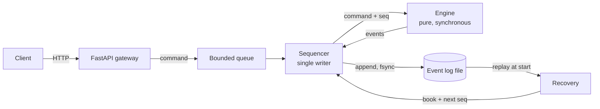

# Orderbook Engine

A limit order book for a single instrument, with an asyncio HTTP service around
it. The matching engine is deliberately conventional: price-time priority, the
rules in [docs/SPEC.md](docs/SPEC.md), nothing exotic. The design effort is in
the service around it: how commands are ordered, made durable and replayed, and
what happens when something fails.

Python 3.13, asyncio, FastAPI, [uv](https://docs.astral.sh/uv/). Typed code
checked by pyright in strict mode. The engine's invariants are checked with
Hypothesis property tests.

## Architecture



The sequencer takes one command at a time. It gives the command the next
sequence number, runs it through the engine, appends one record (command, seq
and events) to the log, and only then answers the client. At start-up it
rebuilds the book by running the logged commands through the engine again.

Imports point inward only: `adapters -> app -> engine -> domain`, with `replay`
between `engine` and `app`.

| Package    | What is in it                                                              | May import                   |
| ---------- | -------------------------------------------------------------------------- | ---------------------------- |
| `domain`   | Orders, trades, commands, events. Standard library only.                   | nothing in the project       |
| `engine`   | Order book and matching. No I/O, clocks, randomness or asyncio.            | `domain`                     |
| `replay`   | Replay of a command list through the engine, and the state checksum.       | `engine`, `domain`           |
| `app`      | Sequencer, log record format, `EventLog` protocol, recovery. asyncio here. | `replay`, `engine`, `domain` |
| `adapters` | FastAPI gateway, file log, server entry point.                             | `app`, `engine`, `domain`    |

The rule is kept by review. No test enforces it.

The reasoning behind the sequencer, the file log and the API is in the module
docstrings of [`sequencer.py`](src/orderbook_engine/app/sequencer.py),
[`file_log.py`](src/orderbook_engine/adapters/file_log.py) and
[`app.py`](src/orderbook_engine/adapters/api/app.py).

## Guarantees

- **Total order.** One sequencer assigns sequence numbers 1, 2, 3, ... to the
  commands it processes, and the log holds them in that order. Cancels and
  commands the engine rejects take a number too.
- **Deterministic engine.** The same commands in the same order always give the
  same events and the same book. Ordering uses sequence numbers, never
  timestamps.
- **Acknowledged after append.** A command's response is sent only after its
  record has been appended to the log and, with the file log's default
  setting, flushed with `fsync`. This relies on the operating system and disk
  honouring `fsync`. The append runs on the event loop and waits for `fsync`,
  so every other request waits too.
- **Torn-write recovery.** When the file log opens, it truncates a final record
  that is incomplete or fails its checksum. Damage it can recognise elsewhere,
  such as a bad record followed by more data, a gap in sequence numbers or a
  header that is not ours, stops the server from starting and leaves the file
  untouched.
- **Idempotent Submit.** A Submit is identified by participant and client order
  id. An identical repeat returns the original outcome and writes nothing. The
  same id with a different payload is processed as a new command. The table is
  rebuilt from the log at start-up. Cancel and Amend are **not** deduplicated.
- **Explicit overload rejection.** The command queue is bounded. When it is
  full the API answers 503 with `Retry-After`, and nothing was written for that
  command.
- **Fail-stop.** If the engine or the log raises while a command is processed,
  the in-memory book may be ahead of the log. The sequencer stops, the failing
  command and every queued command fail, and the API answers 503 until the
  process is restarted. Restart rebuilds the book from the log.

## What happens when

| Situation                                        | Behaviour                                                                                                                                                                                                                                                                                              |
| ------------------------------------------------ | ------------------------------------------------------------------------------------------------------------------------------------------------------------------------------------------------------------------------------------------------------------------------------------------------------ |
| The server is killed (`kill -9`)                 | On restart the book is rebuilt by replaying the log from the first record, and numbering resumes after the last record. A command that was acknowledged is in the log. Shown in the quick start below.                                                                                                 |
| The process dies in the middle of an append      | The file ends in a partial record. Opening the log truncates it, and the command was never acknowledged. `FileLog.dropped_bytes` reports how much was removed; the server does not log it.                                                                                                         |
| A client times out and retries                   | A repeated Submit gets its original outcome if the first one was logged, and is processed normally if it was not. A repeated Cancel or Amend is processed again: it takes a new seq and is normally rejected as an unknown order.                                                                      |
| The queue is full                                | 503 with `Retry-After: 1`. The command was not queued and nothing was written, so any command can be sent again.                                                                                                                                                                                       |
| The log write fails, or the engine raises        | Fail-stop, as above. The client cannot tell whether the failing command was logged. A Submit can be retried after restart and gets its original outcome if it was logged. A Cancel or Amend cannot be retried that safely.                                                                             |
| The log is corrupt, or does not match the engine | The server does not start. A damaged record that is followed by more data, a gap in sequence numbers or a header that is not ours is reported with its byte offset. A record whose events differ from what the engine produces on replay is reported as a mismatch. Nothing is repaired automatically. |

## Quick start

Needs Python 3.13 and [uv](https://docs.astral.sh/uv/). The commands below are
for macOS and Linux.

```text
uv sync
uv run pytest
```

Start the server. It listens on `http://127.0.0.1:8000` and creates the log
file in the working directory.

```text
ORDERBOOK_LOG_PATH=orderbook.log uv run orderbook-engine
```

Run exactly one server worker. Each worker builds its own sequencer on the
same log file, and two sequencers writing one log corrupt it. The command above
starts one worker. If you start uvicorn yourself with
`--factory orderbook_engine.adapters.main:create_file_app`, do not pass
`--workers`.

In a second terminal, rest a buy order, then send a sell that crosses it:

```text
curl -s -X POST localhost:8000/orders -H 'Content-Type: application/json' \
  -d '{"order_id":"b1","participant_id":"alice","side":"BUY","order_type":"LIMIT","quantity":10,"price":100}'
{"seq":1,"events":[{"type":"Accepted","seq":1,"order":{"order_id":"b1","participant_id":"alice","side":"BUY","order_type":"LIMIT","quantity":10,"price":100,"time_in_force":"GTC"}}]}

curl -s -X POST localhost:8000/orders -H 'Content-Type: application/json' \
  -d '{"order_id":"s1","participant_id":"bob","side":"SELL","order_type":"LIMIT","quantity":4,"price":99}'
{"seq":2,"events":[{"type":"Accepted","seq":2,"order":{"order_id":"s1","participant_id":"bob","side":"SELL","order_type":"LIMIT","quantity":4,"price":99,"time_in_force":"GTC"}},{"type":"Trade","trade_id":1,"price":100,"quantity":4,"aggressor_order_id":"s1","resting_order_id":"b1","aggressor_side":"SELL","aggressor_participant_id":"bob","resting_participant_id":"alice"}]}

curl -s localhost:8000/book
{"bids":[{"price":100,"quantity":6,"orders":1}],"asks":[]}
```

The sell asked for 99 and traded at 100, the resting order's price. Now kill the
server without letting it shut down, start it again on the same log, and read
the book:

```text
kill -9 $(lsof -ti :8000)

ORDERBOOK_LOG_PATH=orderbook.log uv run orderbook-engine

curl -s localhost:8000/book
{"bids":[{"price":100,"quantity":6,"orders":1}],"asks":[]}
```

The book is unchanged. Sending the first `POST /orders` again returns the
original body, `"seq":1`, and writes nothing.

## API

| Method and path          | Body                                                                                                                                                                 | Result                                                                                 |
| ------------------------ | -------------------------------------------------------------------------------------------------------------------------------------------------------------------- | -------------------------------------------------------------------------------------- |
| `POST /orders`           | `order_id`, `participant_id`, `side` (`BUY`/`SELL`), `order_type` (`LIMIT`/`MARKET`), `quantity`, `price` (limit only), `time_in_force` (`GTC`/`IOC`, default `GTC`). `order_id` must not match any live order, from any participant. | `{"seq", "events"}`                                                                    |
| `POST /orders/cancel`    | `order_id`                                                                                                                                                           | `{"seq", "events"}`                                                                    |
| `POST /orders/amend`     | `order_id`, `price`, `quantity` (the new total)                                                                                                                      | `{"seq", "events"}`                                                                    |
| `GET /book`              | query `depth` (optional, at least 1)                                                                                                                                 | `{"bids", "asks"}`: price, total remaining quantity, order count per level, best first |
| `GET /orders/{order_id}` |                                                                                                                                                                      | The order if it is resting on the book now                                             |

Prices are integer ticks and quantities are integer lots. Each event in
`events` has a `type` field naming its kind: `Accepted`, `Rejected`, `Trade`,
`Cancelled` or `Replaced`.

| Status | When                                                                                                                                                                  |
| ------ | --------------------------------------------------------------------------------------------------------------------------------------------------------------------- |
| 200    | The command was processed and logged. An engine rejection, such as cancelling an unknown order, is a normal outcome: it is a 200 with a `Rejected` event in the body. |
| 404    | `GET /orders/{order_id}` for an order that is not resting. An unknown, filled or cancelled order all give the same 404.                                               |
| 422    | The request is invalid: wrong types (`true`, `1.0` and `"100"` are not integers), unknown fields, or a value the domain refuses, such as a market order with a price. |
| 503    | The queue is full. `Retry-After: 1` is sent and nothing was written.                                                                                                  |
| 503    | The sequencer has stopped after a failure. No `Retry-After`. The response does not say whether the command was logged. Restart the process.                           |

## Known limitations

- **Cancel and Amend retries are not deduplicated.** After a timeout or a 503, a
  client cannot tell whether its Cancel or Amend was applied, and a retry is
  processed again. Only Submit is safe to retry.
- **No authentication.** `participant_id` is whatever the client sends, and
  Cancel and Amend carry no participant check, so anyone can cancel or amend
  any order.
- **Recovery can drop good records silently.** A length field damaged to a
  value under the size cap, so that the record seems to run past the end of the
  file, is treated as a torn tail. That record and every record after it are
  truncated, and nothing is logged.
- **Nothing is bounded over time.** The log is never rotated and the
  idempotency table keeps every Submit, so memory and start-up time grow with
  the history.
